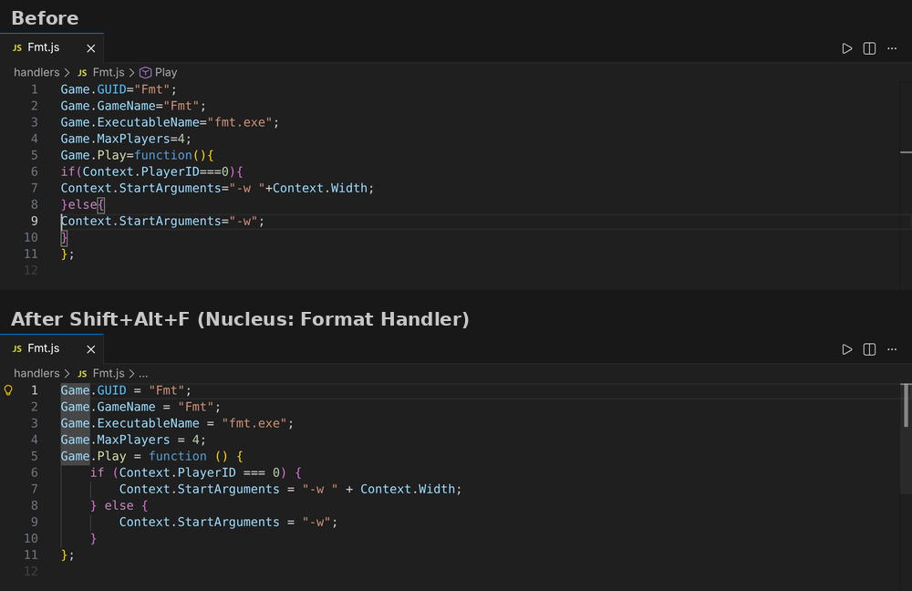
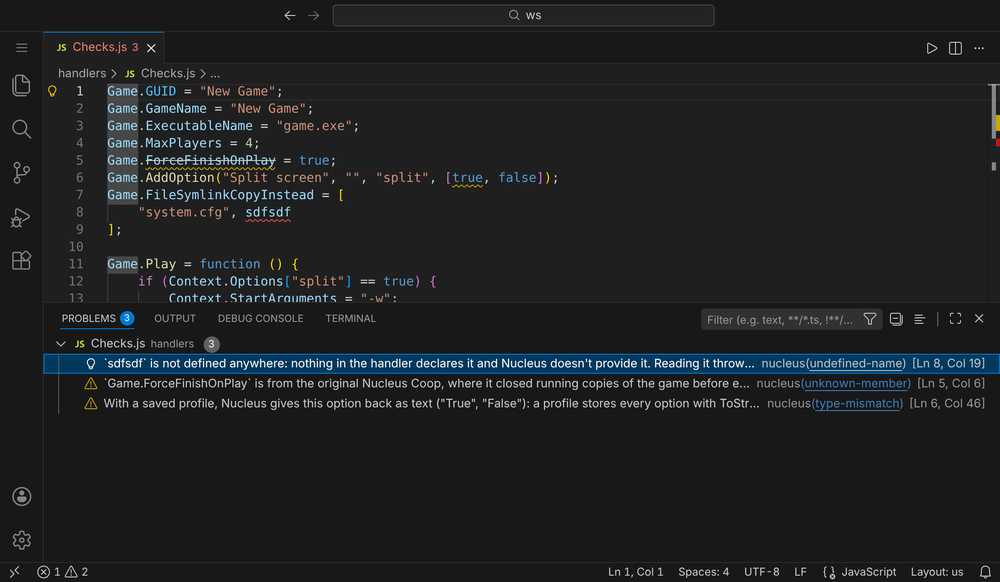
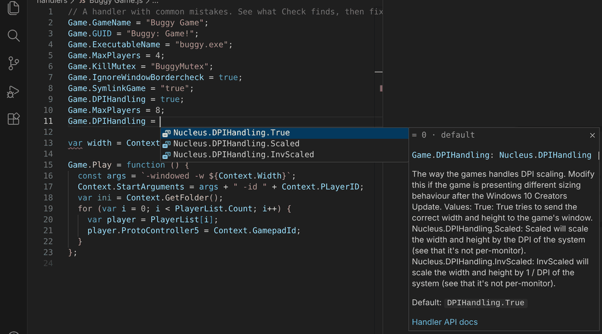
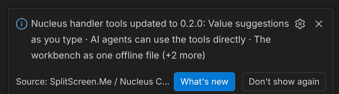

# Changelog

What changed in each release of the SplitScreen.Me / Nucleus Co-op handler tools for VS Code (and the `nucleus` command-line tool and MCP server that ship with it). Newest first.

<!--
How to write it (people and AI agents read this; the release workflow publishes each section as the release notes and refuses to release without one):
- Add each user-visible change under "## Unreleased", in one of these groups, biggest change first:
  ### ✨ New · ### 🛠️ Improved · ### 🐛 Fixed · ### ⚡ Faster · ### ⚠️ Changed (what users must do differently) · ### 🙏 Thanks
- 🙏 Thanks: one line per person who tested, reported a bug or contributed to this release, e.g. "- **Horah** for reporting …". When it came through GitHub (an issue, a pull request, a review), link their profile: "- **[name](https://github.com/name)** for …". Credit them inline too ("Reported by Horah.").
- One line per change: a **short summary** in bold (the update note and the Discord post show only that), then one or two plain sentences.
- A screenshot (or other media) for big, visible changes, folded away in a `

Screenshot
` block indented under its line, with a blank line before and after the image and the closing `  
`; the image line: `  ` (≈1000 px wide, docs/images/changelog/).
- At release: rename "## Unreleased" to "## <version> (beta) · <yyyy-mm-dd>". A `---` line separates releases.
-->

## Unreleased

### ✨ New

- **Checks for the files next to your handler.** The files in `<Name>/` beside `<Name>.js` are checked as they'd go into the .nc: names Windows can't install, two files that overwrite each other, broken INI or JSON, very large files, and a file the handler uses through `Game.Folder` that's probably misspelled ("did you mean Config.json?"). In the Problems panel, `nucleus lint` and `nucleus lsp`; `splitscreenme.lint.packageChecks` turns them off.
- **Hub handlers with all their files.** *Browse Handlers on the Hub › Open handler source* now lays the package out the way Nucleus installs it (`<GameName>.js` and `<GameName>/`), says how many other files it has, and offers **Open as Folder** and **Copy into Workspace**.
- **An outline of your handler.** The Outline view, breadcrumbs and *Go to Symbol* (Ctrl+Shift+O) list the handler's settings grouped by object (Game, Game.ProtoInput, Game.Hook…) with their values, the callbacks with what they set inside, and your own functions and variables. In other editors through `nucleus lsp` too.

---

## 0.4.0 (beta) · 2026-11-07

**The biggest update yet.** Checks that catch settings which quietly do nothing, docs for 150 more API members (and a way to help check them), the same tools in any editor with LSP support, and a first look at stepping through a handler line by line. The workbench got its biggest update too: see its What's new.

### ✨ New

- **Settings that silently do nothing.** Four new checks, each from Nucleus' and Proto Input's source: Proto Input options with no way to start it (`protoinput-inactive`); `BlockedMessages` and the message filters without `Game.ProtoInput.MessageFilterHook` (`protoinput-needs-hook`); a blocked number Proto Input can't block as written (`blocked-message`); and options only read when another is on, like `FakeFocusInterval` without `FakeFocus` (`needs-option`). On the Hub they find 15 handlers with settings that never take effect. Each comes with a fix.
- **Docs for 150 more API members, and you can check them.** Hovers, suggestions and the reference now explain the Proto Input functions and hook IDs, the `Player` members and the most used undocumented options, written from the Nucleus and Proto Input source. Each one is marked as AI-written and says what it's based on, since the official docs don't cover them. Hovers have **Is it wrong? Tell us**, which opens a short GitHub form with the doc attached; once a person confirms one, it says who checked it.
- **Other editors: a Language Server.** `nucleus lsp` brings the checks with their quick fixes, hover docs, suggestions, signature help, Format Document, window-message names and Try it to Neovim, Helix, Zed, Sublime Text, Emacs, JetBrains IDEs, Kate and any other editor with LSP support. [PORTING.md](PORTING.md) has the setup for each one.
- **Step through a handler: `nucleus debug`.** Stop at a line (also only for one player: `--break "14 if Context.PlayerID == 1"`) or where an error ends the run, and see where it is (top of the file, `Game.Play` for player 2 of 4, `Game.OnStop`), the variables, the call stack, `--watch` values and what the handler did so far. The engine behind the coming debugger in VS Code and the workbench.
- **Window messages by name.** In `Game.ProtoInput.BlockedMessages = [0x0008, 0x02a3, 0x02a1]`, each number shows its name after it (`WM_KILLFOCUS`, `WM_MOUSELEAVE`, `WM_MOUSEHOVER`), hovering says what it does and how many Hub handlers block it, and typing inside the brackets suggests the common ones. The names come from Proto Input's own list. Suggested by messenils.

### 🛠️ Improved

- **A typo no longer hides every other problem.** While a line doesn't parse yet (say you're halfway through `player.`), the rest of the handler is still checked, and the error sits on the unfinished code with a plain message ("a name is missing after `player.`") instead of on the next line.
- **Focus loop settings that do nothing.** `Game.ProtoInput.FocusLoop_…` and `FocusLoopIntervalMilliseconds` only work with `Game.ProtoInput.EnableFocusMessageLoop = true`; the `needs-option` check now says so (14 Hub handlers).
- **More suggestions after `=`.** `Game.Play = ` (and the other callbacks) inserts `function () { }` with the cursor inside, and `Game.ProtoInput.BlockedMessages = ` offers the set most Hub handlers block.
- **Set twice: keep either value.** The quick fixes for `duplicate-assignment` now offer both: remove the overwritten line, or keep it and remove the later one.
- **`Hub.*` lines explained.** Hover and `nucleus api` now say what `Hub.Handler.Id`, `Hub.Handler.Version` and `Hub.Maintainer.*` are for (the Hub writes them on upload; Nucleus uses the ID and version to link the handler to its Hub page). They still aren't suggested, since authors don't write them.

### 🐛 Fixed

- **Format Document no longer splits `=>`.** In code that isn't ES5 yet, formatting turned `() => 1` into `() = > 1` (also `**` and `??`); these now stay in one piece.

### 🙏 Thanks

- **messenils** for the idea of naming the window messages.

---

## 0.3.1 (beta) · 2026-11-06

### 🛠️ Improved

- **`Game.SetupSse` no longer suggested.** Nucleus never calls it, so completion and the Lines list leave it out; setting it still gets the warning that it never runs. Reported by messenils.

### 🙏 Thanks

- **messenils** for spotting that `Game.SetupSse` is never called.

---

## 0.3.0 (beta) · 2026-11-05

### ✨ New

- **Format Document for handlers.** Shift+Alt+F re-indents and spaces a handler. It never moves a line (Nucleus runs handlers line by line) and checks that every token and comment is unchanged, so the handler does exactly the same. Also `nucleus format` (`--write`, `--check`) and the MCP tool `nucleus_format`.
  

Screenshot

  

  

- **A changed Game.GUID before it reaches players.** For a handler with a `Hub.Handler.Id` line, VS Code compares `Game.GUID` with the version on the Hub (once per version, cached). Nucleus keys each player's game and profiles by GUID, so a changed one drops the game from their list. Also `nucleus lint --hub`; setting `splitscreenme.lint.compareWithHub`.
- **Option values a saved profile turns into text.** `Game.AddOption(..., [true, false])` gets a warning: a profile gives the value back as `"True"`, so `Context.Options["x"] == true` stops matching. Use text values.
- **Files that aren't UTF-8, and a backslash in GameName.** A file saved as ANSI (accented letters arrive broken in Nucleus) gets a warning, and a `\` in `Game.GameName` is an error: the Hub install names the file after it and fails.
- **Names that don't exist.** A stray word or a typo of a variable (`"system.cfg", sdfsdf`) is now an error: Nucleus throws "sdfsdf is not defined", and at the top level the handler doesn't load. Names from the handler's plugins (`pluginsInfo.txt` in its folder) count as defined.
  

Screenshot

  

  

- **The .NET calls handlers use are known.** `System.IO.File` (Copy, Exists, Delete, ReadAllText…), `System.IO.Directory`, `System.IO.Path.Combine`, `System.Environment.UserName` and `System.Threading.Thread.Sleep` now have completion, hover docs and argument checks, and a typo like `System.IO.File.Exsts` is flagged. Other .NET names are still allowed. Suggested by messenils.
- **Warns about options set too late.** A new `too-late` rule flags `Game.GUID`, `Game.GameName`, `Game.MaxPlayers`, `Game.SupportsKeyboard`, `Game.Description` or `Game.AddOption` inside `Game.Play` or another callback: Nucleus reads them when it loads the handler or on the setup screen, so there they do nothing. Other `Game` options, such as Proto Input or FakeFocus, still work inside `Game.Play`.
- **Checks for options with a fixed format.** A new `value-format` rule catches a `Game.CustomHotkeys` entry that isn't `"true|Toggle HUD|Ctrl|H"` (Nucleus then registers none of them), folder lists without `folder|destination`, a `Game.SteamlessPatch` Nucleus can't read, and a `Game.BinariesFolder` with slashes in the wrong place. Each one would otherwise fail the setup or silently do nothing.
- **Test all combinations in Try it.** One link runs every player count (up to the handler's maximum), input setup and monitor size, and shows which combinations fail and why. Pick a cell to see that run. The same check as the browser workbench's.
- **Try it with a keyboard and mouse for every player.** Choose "each player their own" (or `nucleus simulate --keyboard all`): every player gets their own keyboard and mouse, as in Nucleus' multiple keyboards and mice mode. Try it says so when the handler doesn't set `Game.SupportsMultipleKeyboardsAndMice = true`.

### 🛠️ Improved

- **Screenshots in your theme.** The README's screenshots show VS Code light or dark, matching your theme on GitHub.
- **Calling a name that doesn't exist is an error.** `System.IO.File.Exsts(p)` or a misspelled `Context` function used to be a warning that said the line does nothing; calling it actually throws, so Nucleus stops there. Reading or setting a misspelled name is still a warning.
- **Game.ForceFinishOnPlay is flagged as historical.** It comes from the original Nucleus Coop, where it closed running copies of the game before each player; today's Nucleus doesn't read it and always closes leftover copies when a session starts. The linter now says so in a warning, instead of "probably a typo", with a fix that removes the line.
- **AI agents report their own time.** The agent skill tells AI agents that use WakaTime to register as agents (category `ai coding`, `ai_line_changes`), not as the person.

### 🐛 Fixed

- **Try it's Game.Folder is where the Hub installs the handler.** `handlers\<GameName>` instead of `handlers\MyHandler`, as the Hub install names the folder after the game name.
- **Try it without Game.Play.** Game.OnFinishedSetup now runs, and Game.OnStop sees the last player's Context, as in Nucleus (it reported "Context is not defined" before).
- **Context paths in Try it.** Context.UserProfileConfigPath, UserProfileSavePath and the Documents paths now get the values Nucleus gives them, including moving a "Documents\\" path to DocumentsConfigPath. The docs no longer claim that ten Context values, such as Context.Options, are copied from Game.
- **Try it follows Jint for System calls.** A misspelled System.IO name fails, a call with the wrong number of values fails, and System.Environment.UserName is text, checked against the real engine.

### 🙏 Thanks

- **messenils** for asking for the `System.IO` lines.

---

## 0.2.0 (beta) · 2026-11-05

### ✨ New

- **Value suggestions as you type.** After `=`, completion offers the option's values: `Game.DPIHandling = ` offers `Nucleus.DPIHandling.True`, `.Scaled` and `.InvScaled` with the default first; on/off options offer `true` and `false`.
  

Screenshot

  

  

- **AI agents can use the tools directly.** `nucleus mcp` is an MCP server for Claude Desktop, Cursor, VS Code Copilot and others: check, fix, Try it, API lookup, templates and Hub search. VS Code's agents get it automatically (VS Code 1.101+), and each release includes a single-file `nucleus.js` for other clients.
- **What's new, right here.** After an update, one note shows the highlights, with a button to read them all. **Nucleus: What's New** opens this list any time; `splitscreenme.showWhatsNew` turns the note off.
  

Screenshot

  

  

- **The workbench as one offline file.** Each release includes `workbench.html`, and `nucleus workbench` saves it: open it locally or host it yourself.

### 🛠️ Improved

- **Easier on the Hub.** Searching Hub handlers (command-line tool, MCP server, Browse the Hub) reads our daily copy of the Hub's list instead of the Hub, checked at most once an hour; each handler version is downloaded once, and requests say which tool sent them. Agents are told to fetch one or two handlers, never in bulk.
- **Options and docs stay current.** A daily check notices when Nucleus Co-op or the splitscreen.me docs change and proposes the updated options for review.

---

## 0.1.1 (beta) · 2026-11-05

### 🐛 Fixed

- **No more false Proto Input warning (11 Hub handlers).** `protoinput-legacy-hooks` warned that `HookReRegisterRawInputMouse`/`Keyboard` default to true, but Nucleus only reads them when `HookReRegisterRawInput` (default false) is on.
- **No more false error on `let x` followed by `var x`.** Nucleus' script engine treats `let` and `const` like `var`, so it loads such handlers fine (probe 112; found in a verified Hub handler).

---

## 0.1.0 (beta) · 2026-11-02

### ✨ New

- **Completion, hover and signature help for the whole handler API.** `Game`, `Game.Hook`, `Game.ProtoInput`, `Context`, `Player`, `PlayerList`, `ProtoInput`, `Nucleus.*`, generated from the Nucleus Co-op source and docs.
- **A checker with quick fixes.** 16 rules for what makes handlers fail in Nucleus: ES5-only syntax, misspelled options, `Context` outside `Game.Play`, Hub install pitfalls, wrong value types, ES2015+ functions Nucleus lacks (`.includes()`, `Map`, …). Every rule is checked against Nucleus' real script engine (Jint 2.11.58).
- **Fix all.** Safe automatic fixes, as a command, on save, or `nucleus lint --fix`.
- **Try it.** What Nucleus would set up for each player (window, launch arguments, file changes), beside the editor and as `nucleus simulate`. It follows Nucleus' session and runs the handler isolated from your files.
- **Commands.** New Handler, Package for the Hub (.nc), Install into Nucleus Co-op, Browse the Hub, Set Up Type Definitions, Lint All Handlers, Open Documentation; snippets for common handler tasks; `nucleus.d.ts` type definitions.
