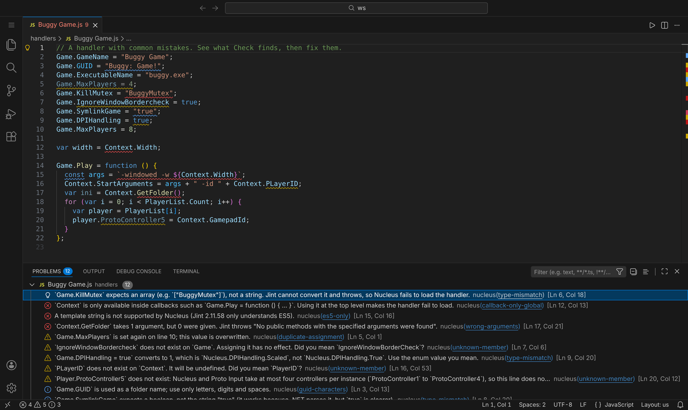
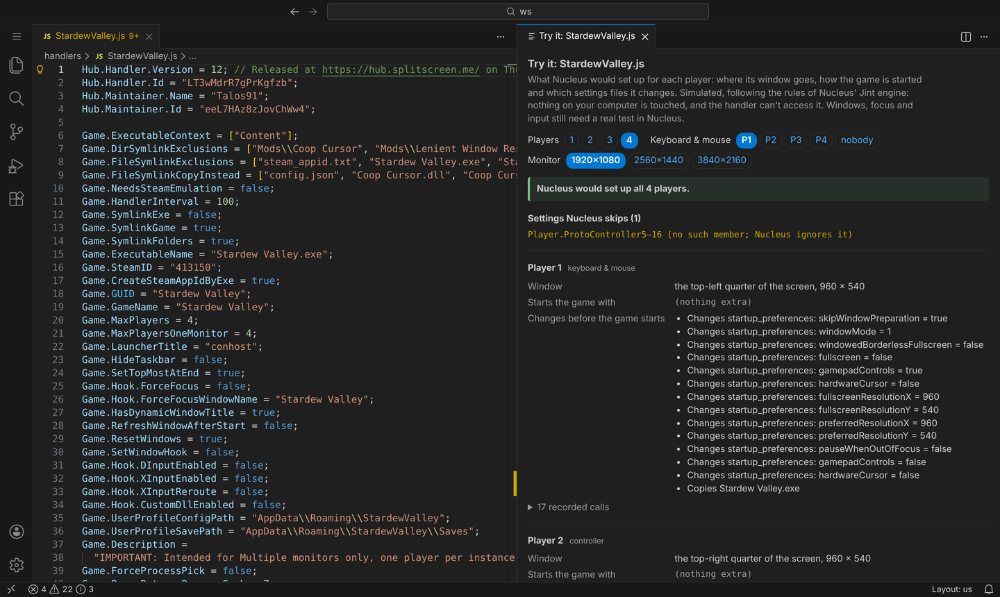
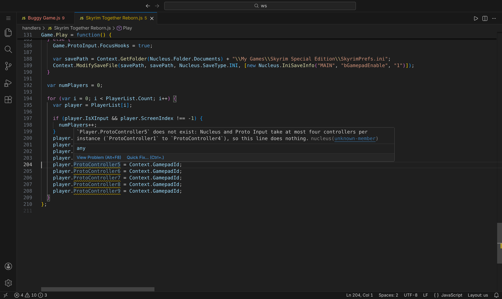
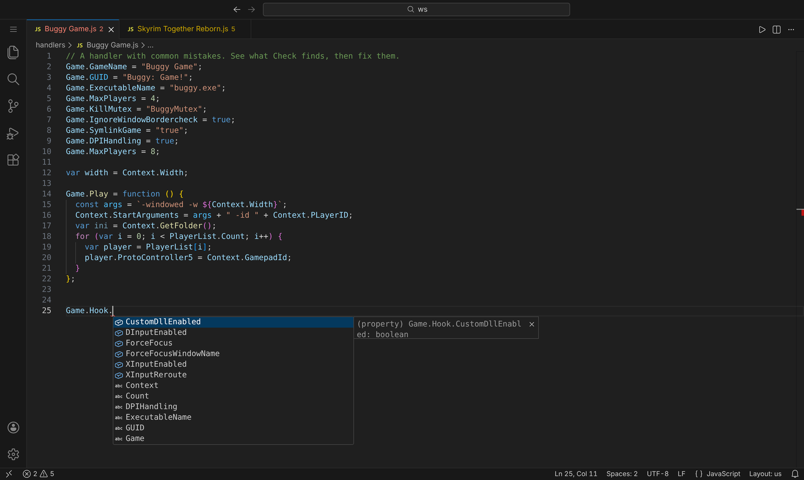
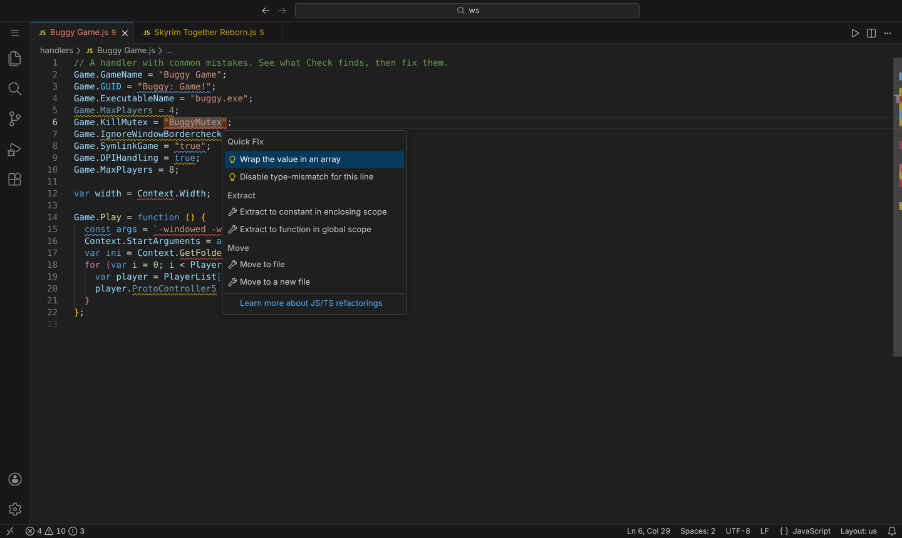

# SplitScreen.Me / Nucleus Co-op Handler Tools for VS Code

Tooling for writing [Nucleus Co-op](https://github.com/SplitScreen-Me/splitscreenme-nucleus) game handlers: the JavaScript files that tell Nucleus how to run several copies of a game side by side.

> **Beta, testers wanted.** Intro, screenshots and a 5-minute install: **https://snailedlt.github.io/nucleuscoop-handler-testbench/start/**

<p>
  
  
</p>
<p>
  
  
  
</p>

*Problems, the **Try it** panel, hover, completion and quick fixes, in VS Code. The same checks run in the [browser workbench](https://snailedlt.github.io/nucleuscoop-handler-testbench/). Testing it? See [TESTING.md](TESTING.md).*

- **IntelliSense** for `Game`, `Game.Hook`, `Game.ProtoInput`, `Context`, `Player`, `PlayerList`, `ProtoInput`, `Hub` and the `Nucleus.*` enums. Completion lists every option Nucleus actually has, with types, defaults and docs. On an empty line, `Game.` completes the whole assignment, e.g. `Game.SymlinkGame = true|false;`.
- **Hover docs** and **signature help** for every `Context` method and its overloads.
- **Linting** for the mistakes that make handlers fail, often silently. See [Lint rules](#lint-rules).
- **Fix all**, deterministic and offline: applies every fix that keeps the handler's behaviour or repairs code Nucleus can't load. It runs as a command, on save, or as `nucleus lint --fix`. Fixes that change behaviour or need your input stay one-click quick fixes. On the 41 engine probes, it takes 11 of the 16 that fail in Jint 2.11.58 to working.
- **Quick fixes**: did-you-mean for typos, `"true"` → `true`, template string → concatenation, wrap a value in an array, add missing required options, and more.
- **New Handler** wizard that generates a handler which passes the linter, with optional Proto Input, Goldberg, INI resolution and user-option sections.
- **Package for the Hub**: builds a `.nc` package laid out the way Nucleus' installer expects.
- **Install into Nucleus**: copies the handler and its asset folder into your Nucleus `handlers` folder.
- **Browse the Hub**: search the 600+ handlers on [hub.splitscreen.me](https://hub.splitscreen.me) and open any handler's source, which is handy for seeing how others solved a problem.
- **Type definitions** (`nucleus.d.ts`), so you can opt into full TypeScript checking with `// @ts-check`.
- **Snippets** (`nc-…`) for common tasks: INI/XML edits, text-file line replacement, registry edits, copying files from the handler folder, options, Goldberg and Proto Input.
- **`nucleus-lint` CLI** that runs the same checks in CI.

The API model is **generated from the Nucleus C# sources** (`GenericGameInfo`, `GameHookInfo`, `GenericContext`, `ProtoInputOptions`, …) and the [splitscreen.me docs](https://www.splitscreen.me/docs/handler-api), so it reflects what Nucleus really accepts rather than a hand-maintained list.

## Getting started

1. Install the extension. Until it is on the Marketplace, download the `.vsix` from the [releases](https://github.com/Snailedlt/splitscreenme-vscode/releases) (or run `npm ci && npm run package`), then **Extensions: Install from VSIX…**. Testing it? See [TESTING.md](TESTING.md).
2. Open the folder where you keep your handlers. Any `.js` file that sets `Game.GUID`, `Game.GameName`, `Game.ExecutableName` or `Game.Play`, or lives in a `handlers` folder, gets handler features. Other JavaScript files are left alone.
3. Run **Nucleus: New Handler…** from the Command Palette, or type `nc-handler` in an empty `.js` file.

### Commands

| Command | What it does |
| --- | --- |
| **Nucleus: New Handler…** | Asks for the game name, executable, Steam app ID and optional features, then writes a ready-to-edit handler. |
| **Nucleus: Try It (Simulate Each Player)** | Opens a panel beside the editor showing what Nucleus would set up for each player: window position and size, launch arguments, the settings files it changes, options Nucleus skips, and errors a player would hit. It updates as you type; pick 1–4 players, the keyboard & mouse player and the monitor size in the panel. Also the ▷ button in the editor title bar. See [Try it](#try-it). |
| **Nucleus: Package Handler for the Hub (.nc)** | Zips `Game.js` as `handler.js`, plus the `Game/` asset folder next to it. Also available in the Explorer context menu. |
| **Nucleus: Install Handler into Nucleus Co-op** | Copies `Game.js` and `Game/` into `<Nucleus>/handlers/`. Asks for your Nucleus folder once (`splitscreenme.nucleusPath`). |
| **Nucleus: Browse Handlers on the Hub…** | Searches hub.splitscreen.me; opens a handler's source or its Hub page. |
| **Nucleus: Set Up Type Definitions** | Writes `.vscode/nucleus.d.ts` and a `jsconfig.json` (ES5 lib), then hands completion over to the TypeScript service. Add `// @ts-check` to a handler for type errors. |
| **Nucleus: Fix All Auto-fixable Problems** | Applies every safe fix to the open handler. To run it on save, add `"editor.codeActionsOnSave": { "source.fixAll.nucleus": "explicit" }`. |
| **Nucleus: Lint All Handlers in Workspace** | Lints every handler in the workspace, not just open files. |
| **Nucleus: Open Documentation…** | Quick links to the handler API, guides, Proto Input, FAQ, Hub and PCGamingWiki. |

Package and Install both refuse to continue if the handler has lint errors, unless you confirm.

### Handler asset folder

Nucleus sets `Game.Folder` to `handlers/<handler file name without .js>/`. Keep files your handler copies (DLLs, configs, …) in a folder with the same name next to the handler:

```
MyGame.js
MyGame/
  steam_api64.dll
```

Package and Install both pick this folder up automatically.

## AI agents

The repo also ships an agent kit, so coding agents (Claude Code, Copilot, Codex, Cursor, …) write handlers that load and work, instead of guessing option names from memory.

- **The `nucleus-handler` skill** (`plugin/skills/nucleus-handler/`) contains:
  - the hard rules: ES5 only, real options only, `Context` only inside callbacks, Hub line format, …;
  - a research → reference handlers → scaffold → lint → test-plan workflow;
  - a symptom-to-option troubleshooting table;
  - lint-clean recipes;
  - a generated, greppable API reference.
- **A bundled CLI** at `plugin/skills/nucleus-handler/scripts/nucleus.js` is a single file with no dependencies; it needs Node. Agents can't see squiggles or hovers, so this gives them the same checks:

  | Command | What it does |
  | --- | --- |
  | `nucleus lint <file> --json` | Diagnostics and available fixes |
  | `nucleus api Game.KillMutex` / `nucleus api --search mutex` | The "hover": type, default and docs |
  | `nucleus hub search <game>` / `nucleus hub fetch <id>` | Study how existing handlers solved the same problem |
  | `nucleus new …` / `nucleus package …` | Scaffold a handler / build the `.nc` package |

### Claude Code

```
/plugin marketplace add SplitScreen-Me/splitscreenme-vscode
/plugin install nucleus-coop@splitscreenme
```

The skill loads automatically when you ask about Nucleus handlers.

### MCP server (Claude Desktop, Cursor, VS Code Copilot, …)

`nucleus mcp` serves the same tools over the [Model Context Protocol](https://modelcontextprotocol.io), for agents that can't run shell commands. Handler code only runs in the isolated simulator.

| Tool | What it does |
| --- | --- |
| `nucleus_lint` | Every problem, with line, rule and available fixes |
| `nucleus_fix` | Apply the safe automatic fixes; returns the fixed source (or saves it) |
| `nucleus_simulate` | Try it: each player's window, launch arguments and file changes |
| `nucleus_api` / `nucleus_api_search` | Type, default and docs of an option; search by words |
| `nucleus_new_handler` | A lint-clean handler from the templates |
| `nucleus_hub_search` / `nucleus_hub_handler` | Find Hub handlers; read a verified one as an example |
| `nucleus_rules` | What each check does |

It also offers the skill's guide as the `nucleus-handler` prompt.

- **VS Code (Copilot agent mode):** nothing to set up. The extension registers the server (VS Code 1.101 or newer); turn it on under **MCP Servers** in the Extensions view or in the agent's tool picker.
- **Anywhere else:** download `nucleus.js` from the [latest release](https://github.com/Snailedlt/splitscreenme-vscode/releases) (one file, needs Node 18+), and add it to your client. For Claude Desktop (`claude_desktop_config.json`) or Cursor (`.cursor/mcp.json`):

  ```json
  { "mcpServers": { "nucleus": { "command": "node", "args": ["/path/to/nucleus.js", "mcp"] } } }
  ```

  Claude Code: `claude mcp add nucleus -- node /path/to/nucleus.js mcp` (or install the plugin above).

### Does the skill help? (evals)

`plugin/evals/` holds six cases built from mistakes found in real handlers: write a UE4 handler from facts, fix a handler that doesn't load, the nonexistent `ProtoController5`+, `.includes()` in `Game.Play`, a review where `DPIHandling = true` hides a bug, and Hub-install lines. `claude plugin eval` runs each with and without the plugin. Its graders can only be regexes and model judges, so `scripts/eval-grade.mjs` then grades every handler the agent wrote with the real linter and Try it.

```bash
claude plugin eval ./plugin --trust-plugin --scaffold --allow-tools Write Edit --runs 2 --keep-temp -j 4 > eval.log 2>&1
node scripts/eval-grade.mjs eval.log --cleanup
```

First run (2 runs per case per arm, $1.48): every case scored 1.00 with the plugin; without it, the agent missed the `DPIHandling` bug, told the user to set `ProtoController5`–`8`, and left a handler that still didn't load. Handlers that load and run in Try it: 10/10 with the plugin, 7/10 without. The **Agent evals** workflow runs the same by hand (it needs an `ANTHROPIC_API_KEY` secret).

### Any agent, in your handler folder

Run **Nucleus: Set Up AI Agent Support** in VS Code, or:

```bash
node path/to/nucleus.js init-agent .
```

This writes three things:
- `.claude/skills/nucleus-handler/`: the skill and the CLI;
- a marked section in `AGENTS.md`, which most agents read;
- `CLAUDE.md`, containing `@AGENTS.md`.

Existing `AGENTS.md`/`CLAUDE.md` content is kept, and re-running only refreshes the kit.

Agents can't run Nucleus or the game, so the skill tells them to finish with a concrete test plan and to ask for Nucleus' `debug-log.txt`.

Contributors' agents: see [AGENTS.md](AGENTS.md).

## Lint rules

| Rule | Default | What it catches |
| --- | --- | --- |
| `syntax-error` | error | The file does not parse. |
| `es5-only` | error | Syntax Jint 2.x cannot parse: arrow functions, template strings, classes, spread/rest, destructuring, default parameters, `for…of`, `?.`, `??`, `**`, trailing commas in calls, `const` in a `for` head, … The handler would not load. Fixes are offered where mechanical. |
| `let-const-semantics` | info | `let`/`const` *are* accepted by Jint 2.x, but behave exactly like `var`: function-scoped and reassignable. |
| `unknown-member` | warning | `Game.IgnoreWindowBordercheck`, `Context.PLayerID`, `player.ProtoController5`, … Jint silently ignores writes to unknown properties of Nucleus objects, and reads return `undefined`. In `"use strict"` code the write throws, so it is an **error** there. Includes a did-you-mean fix. |
| `readonly-member` | warning | Assigning computed values such as `Context.Width`, or methods. |
| `type-mismatch` | warning / error | A non-array for an array option (`Game.KillMutex = "x"`) is an **error**: Jint throws and the handler doesn't load. A `SaveInfo` of the wrong kind in `Context.ModifySaveFile` is a warning (Nucleus skips it: INI files take `IniSaveInfo`, CFG files `CfgSaveInfo`). Also errors: `Game.AddOption` values that aren't a list (Nucleus' options screen fails), and a path in `Game.ExecutableName(s)` (it's compared with the .exe's file name, so it never matches). Booleans for enums are checked against what they convert to: `Game.DPIHandling = true` selects `Scaled`, not `True`. Other mismatches (`Game.HandlerInterval = "100"`, a non-function `Game.Play`, the wrong `Nucleus.*` enum) are warnings. `"true"`/`"false"` strings are only `info`, because .NET parses them. |
| `wrong-arguments` | error | No overload of a `Context`/`ProtoInput` method or `new Nucleus.IniSaveInfo` takes that many arguments. C# default values don't count: Jint 2.11 needs every parameter (`Context.RandomString(8)` throws; pass `RandomString(8, false)`). Also `Game.ShowOptionAsStep` with a key no earlier `Game.AddOption` added (the handler fails to load). Jint throws "No public methods with the specified arguments were found", so the handler fails to load or the instance fails. |
| `missing-required` | error | `Game.GUID`, `Game.GameName` or `Game.ExecutableName` is missing or empty. With only `Game.ExecutableNames` it's a warning: the game can be added, but Nucleus' "Search disks" reads `ExecutableName` without checking and stops with an error for every game (fix: add `ExecutableName`). |
| `callback-only-global` | error | `Context`, `Player`, `PlayerList`, `Handler` or `ProtoInput` used at the top level. They only exist inside callbacks such as `Game.Play`. |
| `missing-builtin` | error / warning | Built-ins newer than ES5 that Jint 2.x doesn't have: `Object.assign`, `Array.from`, `Number.isInteger`, `Math.trunc`, `Map`, `Set`, `Promise`, … (errors), and string/array methods such as `.includes()`, `.startsWith()`, `.find()`, `.repeat()`, `.trimEnd()` (warnings, because the receiver's type isn't known; errors on literals). They throw "Object has no method …" when the code runs. Fixes rewrite `.includes(x)`/`.startsWith(x)` with `indexOf` and `.trimStart()`/`.trimEnd()` with `replace`. `padStart`/`padEnd` do exist. |
| `callback-misuse` | warning / error | `Game.SetupSse` (Nucleus never calls it); `GamePlayBeforeGameSetup` and `GamePlayAfterLaunch` both true (`Game.Play` never runs); `Context.StartArguments` set in a `Game.Play` that runs after launch (no effect); a `Game.CustomHotkeys` entry without its `Game.OnCustomHotKey_N` (**error**: Nucleus calls it without checking and crashes when the hotkey is pressed). |
| `duplicate-assignment` | warning | The same option is set twice at the top level, so the first value is dead. |
| `hub-install-parse` | warning / error | When installing from the Hub (or dropping a .nc/.zip), Nucleus reads `Game.GameName` and `Game.ExecutableName` from the raw text: the first two lines (comments included) that *start with* `game.executablename` or `game.gamename`, ignoring case, taking the text between the first and last `"`. The rule replays that scan. **Error** when the install fails: a matched line without two `"` (single quotes, a variable), or no `Game.ExecutableName` line reached. Warning when Nucleus would read a different line or value (indentation, a quote in a comment, `ExecutableNames` or a commented-out line first). |
| `guid-characters` | info | `Game.GUID` becomes a folder name, so use letters, digits and spaces. |
| `protoinput-legacy-hooks` | warning | The handler uses Proto Input with multiple keyboards/mice but leaves the legacy input options (`Game.HookGetCursorPos`, `Game.SendNormalMouseInput`, …) unset or `true`; several default to `true`. The [Proto Input guide](https://www.splitscreen.me/docs/protoinput) says to set them to `false`. Fix inserts the lines. |
| `deprecated` | hint | Options the docs mark deprecated, such as the pre-Proto Input multi-keyboard settings. |

Change severities with the `splitscreenme.lint.rules` setting, e.g. `{ "deprecated": "off" }`, or with comments:

```js
// nucleus-lint-disable-next-line unknown-member
Game.SomethingNucleusWillAddLater = true;
Game.Other = 1; // nucleus-lint-disable-line
/* nucleus-lint-disable deprecated */   // whole file
```

### How the rules were validated

The linter runs over the 150 most-downloaded handlers on the Hub with **no errors**. The warnings it reports there are real defects: typos such as `Context.PLayerID` and `Game.IgnoreWindowBordercheck`, options that don't exist (`Game.ForceFinishOnPlay`, `Player.ProtoController5`–`17`), and a find-and-replace accident (`Game.PauseEscapeTheBackroomsweenStarts`). The engine behaviours behind the rules were confirmed against Jint 2.11.58 itself: 41 probe handlers were run with Nucleus' engine setup, and the linter reports an error for exactly the probes that fail to load or fail in `Game.Play`.

## Settings

| Setting | Default | |
| --- | --- | --- |
| `splitscreenme.detection` | `auto` | `auto`: handler-looking files and files in a `handlers` folder. `always`: every `.js` file. `off`: disable. |
| `splitscreenme.lint.enable` | `true` | Report problems. |
| `splitscreenme.lint.rules` | `{}` | Per-rule severity: `error`, `warning`, `info`, `hint` or `off`. |
| `splitscreenme.completion.enable` | `true` | The extension's completion/hover/signature help. Turned off by **Set Up Type Definitions**, because TypeScript then provides them. |
| `splitscreenme.nucleusPath` | | Your Nucleus Co-op folder, used by Install. |
| `splitscreenme.showWhatsNew` | `true` | After an update, a short note with what's new. **Nucleus: What's New** opens the changelog any time. |

## Try it

**Nucleus: Try It** and `nucleus simulate` load the handler and run `Game.Play` once per player, the way Nucleus does, without Nucleus or the game. They emulate the rules of Nucleus' engine (Jint 2.11.58): unknown options are skipped, only the first letter of a name is case-insensitive, list and enum values are converted the same way, wrong argument counts throw, and ES2015+ built-ins such as `.includes()` fail. The emulation is checked against the real engine: it predicts the same outcome on all 106 probes of the [testbench](https://github.com/Snailedlt/nucleuscoop-handler-testbench), launch arguments included.

It also follows Nucleus' session flow: an error in `Game.Play` ends the session (later players are never set up), `Game.OnFinishedSetup` and `Game.OnStop` run with the last player's `Context`, `Game.GamePlayAfterLaunch` makes `Context.StartArguments` irrelevant, and paths (`Context.ExePath`, `GetFolder`, ...) depend on `Game.SymlinkGame`/`HardcopyGame`/`HardlinkGame` and `Game.BinariesFolder` as in Nucleus. Plugin globals listed in the handler folder's `pluginsInfo.txt` record their calls.

File, registry and process calls are recorded, never performed. The handler runs in a separate JavaScript realm with no access to Node, VS Code or your files (only text goes in and out), and a time limit stops endless loops, so trying a handler you downloaded is safe. Window placement, focus, input and the game itself still need a real test in Nucleus.

```bash
node dist/cli.js simulate MyGame.js --players 4 --keyboard none --resolution 2560x1440   # --json for scripts and agents
```

The exit code is 1 when the handler fails to load or a player's setup fails.

## Command-line linter

```bash
npm ci && npm run build
node dist/cli.js path/to/handlers   # or `nucleus-lint` once the package is installed
```

`--fix` applies every safe automatic fix and saves the files, and `--fix-dry-run` shows what it would change. It also has `simulate`, `api`, `hub`, `new`, `package` and `init-agent` subcommands (`node dist/cli.js --help`). Lint options: `--json`, `--rule unknown-member=error`, `--quiet` (errors only), `--verbose` (include hints), `--all` (lint every `.js`, not just handler-looking ones), `--list-rules`. The exit code is 1 when there are errors.

## Development

```bash
npm ci
npm run build      # bundle dist/extension.js and dist/cli.js with esbuild
npm test           # node:test suite (linter, completion, zip/packaging, templates, extension glue)
npm run typecheck
npm run package    # build a .vsix
```

Press <kbd>F5</kbd> in VS Code to launch an Extension Development Host.

### Regenerating the API model

`data/nucleus-api.json` and `types/nucleus.d.ts` are generated. Do not edit them by hand. To update them after Nucleus changes:

```bash
git clone --depth 1 https://github.com/SplitScreen-Me/splitscreenme-nucleus ../splitscreenme-nucleus
git clone --depth 1 https://github.com/SplitScreen-Me/splitscreenme-www ../splitscreenme-www
npm run generate   # or: node scripts/generate-api.mjs --nucleus <path> --www <path>
```

The generator parses the public members of the C# classes exposed to handlers, with their types and defaults. It then merges descriptions from `docs/handler-api.mdx`, `docs/create-handlers.md`, `docs/protoinput.md` and `MasterHandler.js`. A weekly workflow (`.github/workflows/update-api.yml`) does this automatically and opens a PR when anything changes.

### Layout

```
src/core/api.ts         typed access to the API model, member resolution, suggestions
src/core/lint.ts        the linter (acorn AST, no VS Code dependency)
src/core/complete.ts    text-based resolution for completion/hover/signature help
src/core/sim.ts         "Try it": runs a handler per player, emulating Jint (also used by the testbench workbench)
src/sandbox.ts          runs sim.ts isolated in a vm context for Node hosts (CLI, extension)
src/tryit.ts            the Try it panel
src/core/templates.ts   New Handler templates
src/core/zip.ts         dependency-free zip reader/writer for .nc packages
src/core/hub.ts         hub.splitscreen.me client
src/extension.ts        VS Code providers
src/commands.ts         VS Code commands
src/cli.ts              the nucleus CLI (nucleus-lint is an alias)
src/mcp.ts              nucleus mcp: the tools as an MCP server
scripts/generate-api.mjs
```

## Links

[Handler API](https://www.splitscreen.me/docs/handler-api) · [Creating handlers](https://www.splitscreen.me/docs/create-handlers) · [Proto Input](https://www.splitscreen.me/docs/protoinput) · [Hub](https://hub.splitscreen.me) · [Nucleus Co-op](https://github.com/SplitScreen-Me/splitscreenme-nucleus) · [r/nucleuscoop](https://www.reddit.com/r/nucleuscoop/)
